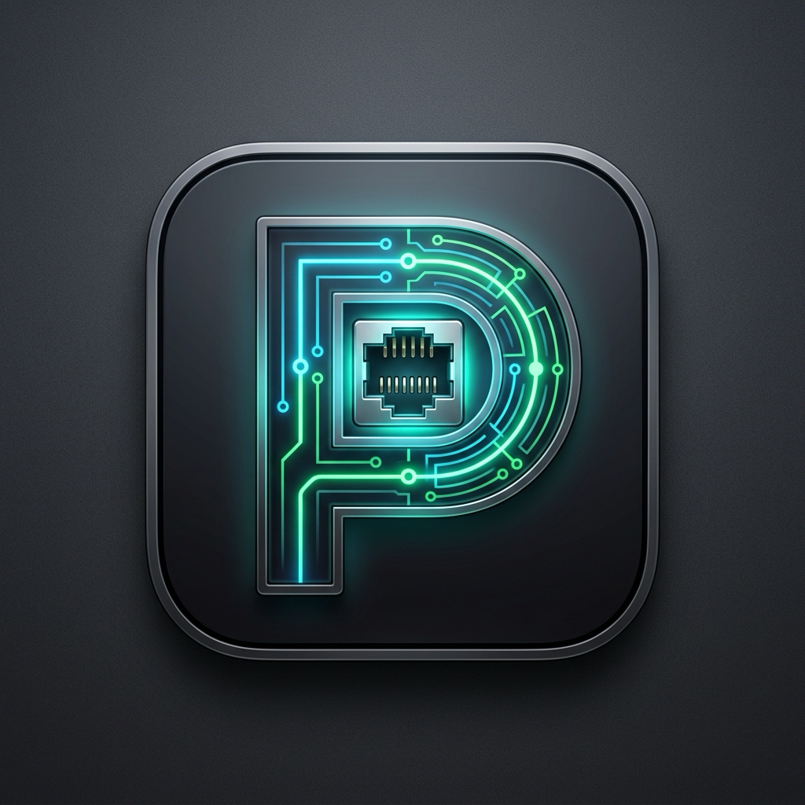

<div align="center">
  
  <h1>PortBar</h1>
  <p>专为 macOS 设计的原生菜单栏（Status Bar）SSH 端口转发与多主机管理客户端</p>

  [](https://github.com/chengruo/port-bar/actions/workflows/ci.yml)
  [](https://apple.com/macos)
  [](LICENSE)
</div>

---

## ⚡️ 一键极速安装 (Quick Install)

只需在 macOS 终端中粘贴并运行以下一行命令即可完成安装并自动启动：

```bash
curl -fsSL https://raw.githubusercontent.com/chengruo/port-bar/main/install.sh | bash
```

> 💡 该脚本会自动下载最新的预编译包，并解除 macOS Gatekeeper 隔离限制，将应用放置在 `/Applications/PortBar.app`。

---

## ✨ 核心特性

- 🖥 **主机单独管理 (SSH Hosts)**：
  - 独立录入远程跳板主机（IP/域名、SSH 端口、用户名、密码、备注）。
  - **明文密码支持**：密码支持明文保存于本地，界面中提供“小眼睛”一键切换显示/隐藏明文。留空则自动回退至本地 SSH 密钥 (`~/.ssh`)。
  - **一键测试连通性**：主机详情页内置“测试 SSH 连通性”功能，提前验证凭据。
  - 统计每台主机名下挂载的转发服务数量。
- 🔀 **端口映射列表 (Port Mappings)**：
  - 维护各个转发服务（如 MySQL 3306、Web 控制台 8080、Redis 6379）。
  - **新增映射时下拉选择关联主机**：一键关联跳板机，无需重复填写服务器信息。
  - 支持**本地端口转发 (`-L`)** 与 **SOCKS5 动态代理 (`-D`)**。
- 🍏 **原生 macOS 菜单栏体验**：
  - 常驻屏幕右上角菜单栏，动态展示正在运行的隧道数。
  - 点击弹出下拉面板：直观列出所有端口转发规则及所属主机标签（如 `[阿里云] :8080 ➔ :8080`），一键连接/断开。
  - 隧道连通后，一键点击“打开浏览器”，直接在默认浏览器中打开本地映射端口。
- 🛠 **原生管理控制台 (Host Manager)**：
  - 经典左右分栏、即时搜索过滤、快捷复制配置、导入/导出 JSON 配置。
  - 内置实时控制台日志窗口，方便秒级排查连接错误与端口占用。
  - 支持键盘标准操作（`⌘C` 复制、`⌘V` 粘贴、`⌘A` 全选、`⌘Z` 撤销、`⇧⌘Z` 重做）。
- 🔒 **轻量免依赖**：
  - 基于 macOS 原生 OpenSSH，内置纯 C 编译的 `portbar-askpass` 认证桥接器，彻底免除安装 `sshpass` 或 Python 第三方依赖。

---

## 🛠 从源码编译与运行

如果你希望本地从源码构建：

```bash
# 1. 克隆代码
git clone https://github.com/chengruo/port-bar.git
cd port-bar

# 2. 本地直接运行
make run

# 3. 或者编译并安装到 /Applications
make install
```

---

## 📁 本地数据存储

配置数据默认持久化保存在标准路径：
```
~/Library/Application Support/PortBar/config_v2.json
```
（在受限环境中会自动平滑回退保存于 `~/.portbar/config_v2.json`）。

---

## CLI 与本地 AI

PortBar 提供 CLI 和配套 [Skill](skills/portbar/SKILL.md)。CLI 与界面操作同一个应用实例，配置和 SSH 进程由应用统一管理。无需 MCP 或 Python 运行时。

### 启用与安装

1. 打开 PortBar 管理窗口，点击设置，在“AI 与 CLI 自动化”中选择权限。默认关闭；可选只读、查询与隧道控制、查询控制与配置编辑。
2. 点击“复制 CLI 命令”可立即使用完整路径。也可点击“安装 CLI…”选择 PATH 中的 bin 目录，创建 `portbar` 链接；不会覆盖已有文件。
3. 点击“安装 AI Skill…”选择 AI 客户端的 skills 目录。应用会创建 `portbar/SKILL.md`，然后按客户端的方式刷新 Skill。安装 Skill 不会自动授予 CLI 权限。

未安装到 PATH 时，也可以直接使用：

```bash
/Applications/PortBar.app/Contents/Helpers/portbar --help
# 从当前仓库构建时
./build/PortBar.app/Contents/Helpers/portbar --help
```

CLI 不会自动启动应用；应用未运行时返回 `APP_NOT_RUNNING`。手动启动应用仍会触发原有 `autoStart` 配置。应用退出会断开隧道。

### 常用操作

```bash
portbar capabilities --json
portbar hosts list --json
portbar mappings list --search dev --json
portbar tunnels start --mapping-id <UUID> --wait --timeout 15 --json
portbar tunnels status --mapping-id <UUID> --json
portbar tunnels diagnose --mapping-id <UUID> --json
portbar logs list --mapping-id <UUID> --limit 30 --json
portbar tunnels stop --mapping-id <UUID> --wait --json
portbar schema --json
```

`--json` 保证 stdout 为单个 JSON 对象，失败包含 `ok: false` 和 `error.code/message`，并返回非零退出码。退出码：0 成功、2 参数错误、3 应用不可用或通信失败、4 权限不足、5 操作失败、6 等待超时。列表默认最多 100 条，`--limit` 支持 1–500；资源操作使用 UUID，名称搜索仅用于发现。

`connected` 代表所有本地端口已监听，不代表远端数据库或网站健康。重复启动已连接隧道不会重连。启停响应包含 `operationId`；`--wait` 在操作被替代时返回 `OPERATION_SUPERSEDED`。等待超时不会取消操作，请先查询状态。

### 创建与修改配置

```bash
# 先取得主机 UUID，然后写入 mapping.json：
cat > mapping.json <<'JSON'
{
  "name": "开发数据库",
  "hostId": "替换为主机 UUID",
  "forwardType": "local_port",
  "portRules": [
    { "localPort": 13306, "remoteHost": "127.0.0.1", "remotePort": 3306 }
  ],
  "autoReconnect": false,
  "autoStart": false
}
JSON
portbar mappings create --file mapping.json --dry-run --json
# 使用预检查响应中的顶层 revision 提交：
portbar mappings create --file mapping.json --if-revision <REVISION> --json
```

主机支持 `hosts create/update/delete`，映射支持 `mappings create/update/delete`。创建主机至少提供 `host`；创建映射至少提供 `hostId`。修改仅替换提供的字段，`portRules` 作为完整数组替换；不接受 null、未知字段、密码或私钥。完整字段和默认值见 `portbar schema --json`、`portbar --help`。JSON 文件限制 256 KiB，也可用 `--file -` 从 stdin 输入。

`--dry-run` 返回脱敏后的 before/after、受影响映射 ID 和当前 revision，不写入配置。创建预览中的 UUID 为临时值，后续操作应使用实际提交返回的 UUID。`--if-revision` 可防止覆盖其他操作刚保存的配置；冲突时重新读取并预检查。配置成功写盘后才向调用方报告成功。

修改或删除运行中的资源会返回 `RESOURCE_BUSY`；请先停止相关隧道及自动重连。删除有关联映射的主机需要显式 `--cascade`，可先 `--dry-run` 查看范围。保存不会立即启动连接，`autoStart` 在下次应用启动时生效。

### Skill 与访问边界

Skill 随应用打包、与 CLI 同步发布，也可手动安装到客户端的 skills 目录：

```bash
portbar skill install --directory /path/to/client/skills --json
```

目标 `portbar` 目录已存在时拒绝覆盖。未安装 Skill 也可直接使用 CLI。

本地接口使用 `/tmp/portbar-<uid>/control.sock`，目录权限 0700、socket 权限 0600，并检查调用进程的用户 ID。访问权限适用于同一 macOS 用户下的所有本地程序，不提供按 AI 客户端隔离。密码字段不对 CLI 开放，返回的备注和日志会替换已保存的密码；请勿将其他凭据写入备注。新增保存的配置文件权限为 0600。CLI 不提供任意远程命令执行。

关闭 CLI 权限会拒绝后续请求，已有连接继续运行，可在界面中停止。设置页和 `activity list` 展示本次应用运行中最近 100 次调用的时间、命令和结果码，不记录请求内容。

### 验证

```bash
make test
```

测试使用独立临时配置和本地模拟 SSH 进程，覆盖权限、预检查、版本冲突、保存失败、脱敏、隧道幂等操作、多端口就绪判断，以及实际打包 CLI 的跨进程调用与 Skill 安装，不连接真实服务器或修改用户配置。

---

## 🤝 开源与贡献

欢迎提交 Issue 或 Pull Request 共同改进 PortBar！
